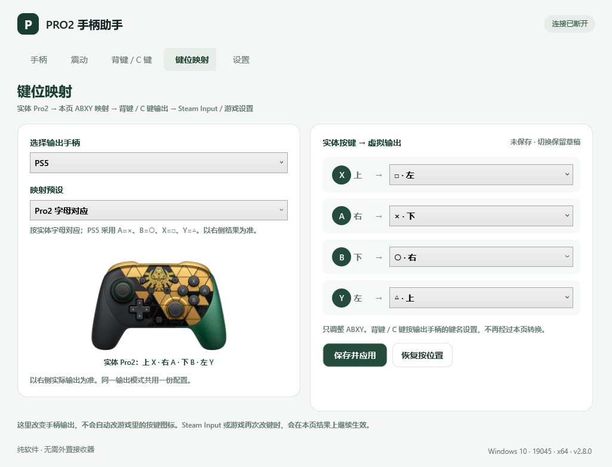

# PRO2 手柄助手

让 **Nintendo Switch 2 Pro（Pro2）手柄无线连接 Windows**，直接用于 Steam，也能切换成 Pro1、Xbox 或 PS5 兼容手柄。纯软件连接，无需专用接收器。

**[推荐下载：v2.8 Windows EXE](https://github.com/LeonChrome/XinHeLianSheng-Pro2-Bridge/releases/download/pro2-v2.8/PRO2ControllerAssistant-v2.8-win-x64.exe)** · [版本说明](docs/RELEASE_v2.8_ZH.md)

启动即闪退、窗口不显示时：[尝试 v2.8 兼容启动版](https://github.com/LeonChrome/XinHeLianSheng-Pro2-Bridge/releases/download/pro2-v2.8/PRO2ControllerAssistant-v2.8-ui-compatible-win-x64.exe)。仅改界面渲染，手柄功能相同。先从托盘退出旧版再打开。

## 能做什么

- **四种模式**：Steam / Pro2、Pro1、Xbox、PS5 兼容输出。
- **ABXY 键位映射**：独立页面选择位置、Pro2 字母对应预设，或自定义四个键；四种模式分别保存，未连接也能设置。
- **多手柄管理**：四个槽位各自选择 Pro2、Pro1、Xbox 或 PS5，可同模式或混用；单只切换不重连实体 BLE，不重建其他手柄的输出。
- **背键 / C 键自定义**：Pro1、Xbox、PS5 模式支持单键、组合键、连发、顺序动作和延迟；没连接手柄也能设置。
- **PS5 触控板模拟**：背键 / C 键可映射轻触、四向滑动和顺逆时针画圈，支持时长和延迟；游戏需支持触控板。
- **震动与体感**：震动强度调节、PS5 普通震动与触觉转换、陀螺仪校准；Xbox 模式不含原生体感。
- **手柄状态**：真实输入频率、电量档位、固件版本、耳机插入状态；安全检查通过时每 10 分钟更新电量。
- **自动休眠**：可设置闲置时长，休眠时虚拟手柄保持在线，按手柄按键唤醒后自动重连。默认关闭。
- **连接与诊断**：首页显示连接失败或低速原因线索，系统信息保留各只手柄的失败阶段、返回码和优化结果；设置中可手动重启蓝牙。
- **游戏按键图标**：已适配《影之刃零》Steam 版。保持 PS5 模式，按实际位置显示 Pro2 键名；自动查找多 Steam 库，支持安装、更新和还原。

**自动休眠配对提醒：** 启用后会把本机写入手柄的配对记录，可能挤掉原来的 NS2（Nintendo Switch 2）主机记录。如果回到 NS2 时连不上，重新与主机配对即可。

## 怎么用

1. 下载 EXE，退出旧版；手柄保持 **PRO2 模式**，开启配对广播。
2. 打开软件，点击“连接 Pro2”，选择游戏模式。无需先在 Windows 蓝牙设置中添加手柄。
3. 首次使用按提示安装内置 **USBIP 驱动**，可能需要管理员授权或重启。无需另装 .NET 或 VIIPER；已有 USBIP 支持自动查找或手动指定位置。
4. 使用多只手柄时，先让第一只进入游戏，再到首页“多手柄”为其他槽位逐只连接；各自选模式后点“应用模式”。首页模式仅控制手柄 1。

## 速率与兼容性

支持 **Windows 10 2004 及以上 / Windows 11 x64**，电脑需有可用的 BLE 蓝牙。

目标是真实 **133Hz**，达到 **60Hz** 也允许游玩；低速时首页给出诊断和优化建议。Win11 自动尝试连接参数；Win10 增加首页连接引导，符合条件时显示“一键优化到 133Hz · Win10”：按提示授权后自动备份、配置、尝试重启蓝牙并实测速率；可在“Win10 蓝牙 · 高级”恢复。Win10 优化会改变系统全局 BLE 参数，可能影响其他蓝牙设备或需要重启。

实际速率受系统、适配器和驱动影响，不保证所有电脑达到 133Hz。首页显示真实 FD2 输入，虚拟 USB 重复报告不计入其中。PS5 触觉为转换输出，不承诺物理无损；无线耳机音频和跨设备蓝牙转发尚不支持。

多手柄已通过四路离线输入、反馈隔离和休眠故障模拟检查，**多只实体手柄的无线长测仍待验证**。实际并发数量、每只速率与休眠唤醒情况以对应电脑实测为准。驱动日期或标称蓝牙版本不能单独证明不兼容，证据不足时程序会明确提示。

## v2.8 更新

- 新增键位映射页和手柄图片，清楚显示实体按键对应的输出。
- 修复旧数据流误删虚拟设备、同一手柄重复挂载的问题。
- USBIP 异常时只恢复对应手柄，限制自动重试次数；首页分别显示蓝牙连接与虚拟输出状态。
- 系统与蓝牙信息补充虚拟手柄状态、相关系统设备事件，便于排查连接失败。

**键位以哪里为准？** 默认按位置对应：Pro2 下方 B → Xbox A / PS5 ×。选择“Pro2 字母对应”或自定义后，以映射页列出的输出为准；Steam Input 和游戏里的改键会继续叠加。背键 / C 键单独设置，不会再经过 ABXY 二次转换。同种输出模式的多只手柄共用该模式的 ABXY 配置。

已通过离线回归和标准版、兼容启动版的 EXE 启动检查；反馈故障的电脑仍需实测，不保证解决所有蓝牙或驱动问题。

[完整版本说明](docs/RELEASE_v2.8_ZH.md)

[反馈问题](https://github.com/LeonChrome/XinHeLianSheng-Pro2-Bridge/issues) · [源码与构建](source/final-three-in-one/README.md) · [许可证](LICENSE) · [第三方致谢](ACKNOWLEDGEMENTS.md) · [历史三合一版本](docs/HISTORICAL_THREE_IN_ONE_README.md)
