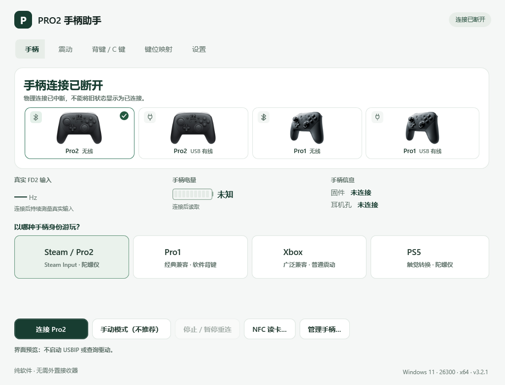

# PRO2 手柄助手

让 **Nintendo Switch 2 Pro（Pro2）手柄连接 Windows**，用于 Steam，也能切换成 Pro1、Xbox 或 PS5 兼容手柄。Pro2 无线连接无需专用接收器。

**[推荐下载：v3.2.1 Windows EXE](https://github.com/LeonChrome/XinHeLianSheng-Pro2-Bridge/releases/download/pro2-v3.2.1/PRO2ControllerAssistant-v3.2.1-win-x64.exe)** · [备用 ZIP 文件夹版](https://github.com/LeonChrome/XinHeLianSheng-Pro2-Bridge/releases/download/pro2-v3.2.1/PRO2ControllerAssistant-v3.2.1-portable-win-x64.zip) · [更新说明](docs/RELEASE_v3.2.1_ZH.md)

EXE 首次打开会准备内置运行文件，请稍等几秒；ZIP 需完整解压。两者均自带 .NET 和 VIIPER。

## 主要功能

- **连接方式**：首页统一选择 Pro2 无线／USB、Pro1 蓝牙／USB；四个槽位分别记住设备和连接方式，可混用。Pro1 输入属于新增路线，仍待更多实机验证。
- **四种游戏身份**：Steam / Pro2、Pro1、Xbox、PS5，各手柄独立选择。
- **键位与摇杆**：ABXY 按位置、字母或自定义映射，左右摇杆死区独立调节；未连接也能设置。
- **背键 / C 键**：Pro1、Xbox、PS5 输出支持单键、组合键、连发、顺序动作和延迟；PS5 可模拟触控板点击、滑动与画圈。
- **震动与体感**：震动强度调节、PS5 普通震动与触觉转换、摇杆和陀螺仪校准。Xbox 模式不含原生体感。
- **连接诊断**：真实输入频率、电量档位、固件、耳机状态；自动重连、可选休眠、蓝牙优化与虚拟 USB 故障诊断。
- **游戏图标**：《影之刃零》Steam 版可按实际位置显示 Pro2 键名，支持查找多个 Steam 库、安装与还原。

## 使用方法

1. 从托盘退出旧助手，运行新版。**上方选实际手柄和连接方式，下方选游戏里的手柄身份。**
2. Pro2 无线：开启配对广播后在助手连接，无需先添加到 Windows 蓝牙。Pro1 无线：先在 Windows 配对，再在助手选择设备。有线使用 USB 数据线；Pro2 USB 先退出 Steam，接入助手后再启动 Steam。
3. 点击连接。首次按提示安装内置 **USBIP 驱动**，可能需要管理员授权或重启。已安装但未找到时，手动选择安装目录中的 `usbip.exe`。多只手柄进入“管理手柄”。

默认按位置对应：**Pro2 下方 B → Xbox A / PS5 ×**；可在“键位映射”修改。Steam Input 和游戏自身改键仍会继续生效，同种输出模式共用该模式的映射配置。背键 / C 键单独设置，实体 Pro1 没有这些按键。

Pro2 USB 的厂商命令接口需要已有 WinUSB 绑定，程序不会自动替换设备驱动。完整接入条件、校准和 NFC 范围见 [输入方式与限制](docs/physical-inputs.md)。

## v3.2.1 更新

- 统一四种连接图卡和多手柄窗口，加入高清手柄图、悬停与选中动效。
- 默认连接时优先 133Hz；Win11 可恢复同一环境已验证的 7.5ms 方案，并重新测量真实输入。
- **Windows 代码 19** 单独判为虚拟设备配置异常，停止无效反复挂载。首页可备份并重建当前虚拟手柄，诊断中显示服务和筛选器信息；不重启蓝牙，不清理其他手柄。
- 输入可用而虚拟输出失败时，界面明确区分，避免显示成已经可以游玩。

遇到代码 19，可点首页“修复虚拟手柄”并授权。若是共享筛选驱动残留，设备重建可能仍失败，需要按诊断修复对应软件；不能保证一次治愈所有系统配置问题。

## 兼容性

支持 **Windows 10 2004 及以上 / Windows 11 x64**。Pro2 无线需要可用的 BLE 蓝牙，目标为真实 **133Hz**，达到 **60Hz** 也允许兼容游玩。Win11 自动尝试参数；Win10 按首页引导授权优化，修改前备份并提供恢复。Win10 全局 BLE 参数可能影响其他蓝牙设备或需要重启。

实际频率受系统、适配器、驱动与无线环境影响，不保证所有电脑达到 133Hz。虚拟重复报告不算新输入。Pro2 USB 曾完成约 30 秒 249.99Hz 实测；Pro1 输入、实卡 NFC、四只实体手柄并发及各模式长时间游戏仍需更多验收。PS5 触觉属于转换输出；无线耳机音频和跨设备蓝牙转发尚不支持。

**自动休眠默认关闭。** 启用后本机可能占用手柄配对记录；回 NS2 主机时若连不上，重新配对即可。

[反馈问题](https://github.com/LeonChrome/XinHeLianSheng-Pro2-Bridge/issues) · [源码与构建](source/final-three-in-one/README.md) · [许可证](LICENSE) · [第三方致谢](ACKNOWLEDGEMENTS.md) · [历史版本](https://github.com/LeonChrome/XinHeLianSheng-Pro2-Bridge/releases)
