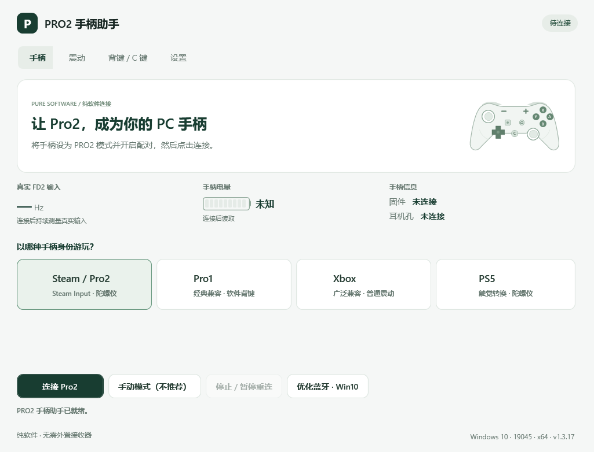

# PRO2 手柄助手

让 **Switch 2 Pro（Pro2）手柄无线接入 Windows**，支持 Steam / Pro2、Pro1、Xbox 与 PS5 兼容模式。纯软件连接，无需 ESP、Pico 或外置接收器。

**[下载 v1.3.18](https://github.com/LeonChrome/XinHeLianSheng-Pro2-Bridge/releases/tag/pro2-v1.3.18)** · [更新说明](docs/RELEASE_v1.3.18_ZH.md) · [源码与构建](source/final-three-in-one/README.md)

## 功能

- 四种游戏模式：Steam / Pro2、Pro1、Xbox、PS5。
- Pro1 / Xbox / PS5 支持背键与 C 键映射：单键、组合键、连发、顺序动作、延迟；未连接也可设置。
- 陀螺仪校准、震动强度调节、PS5 触觉转换。
- 显示真实输入频率、电量档位、固件、耳机插入状态及系统 / 蓝牙诊断。
- “系统与蓝牙信息”直接显示每组预设的请求状态、实测间隔和最终结果，复制全部信息即可反馈。
- 自动重连；真实输入达到 60Hz 可兼容游玩，首页提示低速原因与优化建议。

## 使用

1. 下载 EXE，退出旧版。手柄使用 **PRO2 模式**，开启配对广播。
2. 在软件中点击“连接 Pro2”，选择游戏模式。无需先在 Windows 蓝牙设置中添加手柄。
3. 首次使用按提示安装内置 **USBIP 内核驱动**；可能需要管理员授权或重启。无需另装 .NET、VIIPER；已有 USBIP 支持自动查找或手动指定位置。

## 蓝牙速率

目标为**真实 133Hz 输入**。真实 FD2 / Parsed 均达到 60Hz 且输入正常时允许游玩；低速时首页显示诊断，不用重复帧伪造回报率。

- **Win11**：自动尝试连接参数，实测后选用较优方案。
- 每组请求、异常返回码、完整测量和恢复记录在“系统与蓝牙信息”查看；缺失记录明确标注，不推测请求成功。
- **Win10**：首页“优化蓝牙 · Win10” → 默认“固定 7.5ms” → “授权并测试”。提供三组预设、自动备份和“恢复原参数”；打开选项不会修改系统。
- Win10 优化会修改系统全局 BLE 参数，其他蓝牙设备可能暂时断开；不能安全重启蓝牙时会提示重启 Windows。

实际速率取决于系统、蓝牙适配器与驱动，**不保证所有电脑达到 133Hz**。请求成功不代表实际提速，以首页实测为准。

## 支持范围

Windows 10 2004 及以上 / Windows 11 **x64**，需可用的 BLE 蓝牙适配器。PS5 模式是兼容输出与触觉转换，不等于完整复刻 DualSense。无线耳机音频、跨设备蓝牙转发不在当前正式功能内。

旧三合一源码与下载保留作历史参考：[历史说明](docs/HISTORICAL_THREE_IN_ONE_README.md)。当前版本只维护纯软件路线，不修改历史硬件版本。

[许可证](LICENSE) · [第三方致谢](ACKNOWLEDGEMENTS.md) · [反馈问题](https://github.com/LeonChrome/XinHeLianSheng-Pro2-Bridge/issues)
