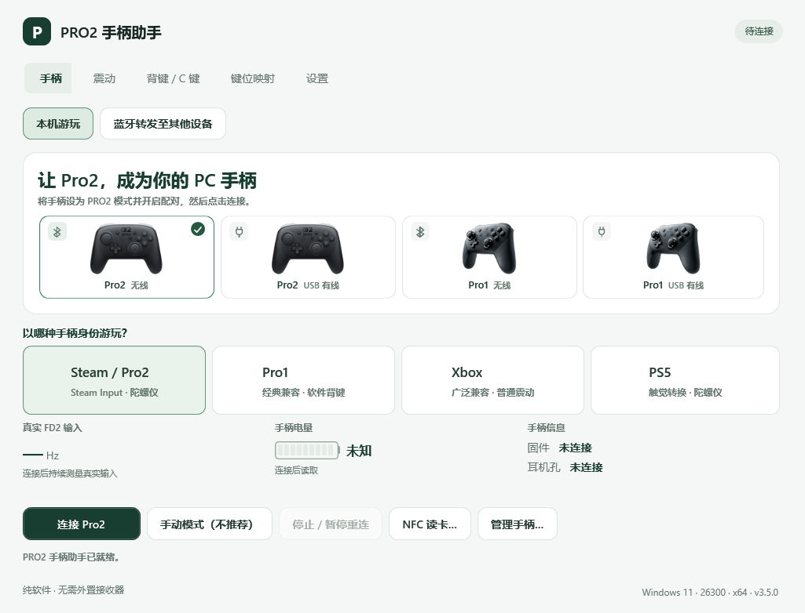

# PRO2 手柄助手

让 Nintendo Switch 2 Pro（Pro2）手柄在 Windows 上用于 Steam 和其他游戏，也能转换成 Pro1、Xbox 或 PS5 兼容手柄。

**[推荐下载：v3.5.0 Windows EXE](https://github.com/LeonChrome/XinHeLianSheng-Pro2-Bridge/releases/download/pro2-v3.5.0/PRO2ControllerAssistant-v3.5.0-win-x64.exe)** · [源码与构建依赖包](https://github.com/LeonChrome/XinHeLianSheng-Pro2-Bridge/releases/download/pro2-v3.5.0/PRO2ControllerAssistant-v3.5.0-source.zip) · [更新说明](docs/RELEASE-v3.5.0.md)

支持 Windows 10 2004 及以上 / Windows 11 x64。EXE 自带 .NET 和运行组件，无需另装 .NET。

## 主要功能

- **四种输入**：Pro2 无线 / USB、Pro1 蓝牙 / USB，在同一首页选择。
- **本机游玩**：Steam / Pro2、Pro1、Xbox、PS5 四种输出；最多四个槽位，各自选择输入与身份。
- **蓝牙转发**：将手柄输入发给其他设备，可选 Pro1、Xbox、PS5 身份及蓝牙适配器；与本机输出共用首页。
- **改键与背键**：ABXY 按位置、字母或自定义映射；背键 / C 键支持组合键、连发、顺序动作、延迟及 PS5 触控手势。
- **震动与体感**：调节震动强度、校准摇杆与陀螺仪、设置摇杆死区；Xbox 协议不含体感。
- **NFC 与诊断**：Pro2 无线 / USB 只读 amiibo，校验后保存 540 字节文件；显示真实输入频率、电量、固件和连接诊断。支持自动重连、可选休眠与蓝牙优化。
- **游戏图标**：《影之刃零》Steam 版可按手柄实际位置显示 Pro2 键名，支持安装与还原。

## 怎么使用

1. 从托盘退出旧助手，打开新版，选择实际手柄和有线 / 无线连接方式。
2. Pro2 无线：开启手柄配对广播，在助手连接。Pro1 无线：先在 Windows 配对，再选设备。有线需 USB 数据线；Pro2 USB 请先接入助手，再启动 Steam。
3. **本机游玩**：选手柄身份并连接。首次按提示安装内置 USBIP 驱动；找不到已有安装时，可手动选择 `usbip.exe`。
4. **蓝牙转发**：选外发身份和发射适配器，点“连接并转发”，接收设备再搜索配对。USB 输入需要一只发射器；无线输入还需要另一只系统蓝牙。只接管所选适配器，停止或退出后恢复临时切换的驱动。

默认按实际位置对应：**Pro2 下方 B → Xbox A / PS5 ×**。“键位映射”可修改，Steam Input 和游戏自身改键仍会叠加。

## 兼容范围

- Pro2 BLE 目标为真实 133Hz，达到 60Hz 也允许兼容游玩。Win11 自动尝试参数；Win10 按首页引导授权优化，修改前备份并提供恢复。实际速度取决于系统、驱动、适配器和无线环境，不保证每台电脑都达到目标。
- **蓝牙外发目前覆盖 Realtek 0BDA:0852、Actions 10D7:B012**，一次转发一只实体手柄；不代表任意蓝牙型号均可发射。准备发射器会暂时中断它原有的蓝牙连接。
- Pro1 外发已验证按键与摇杆响应；Xbox / PS5 外发通过离线检查，仍待不同接收设备实测。PS5 外发目前支持普通震动与体感，未接入蓝牙原生触觉音频、自适应扳机或 PS5 主机认证；Xbox 主机认证也未实现。原生 Pro2 蓝牙身份暂不外发。
- NFC 是只读实验，不写卡、不验证 amiibo 真实性；文件可供兼容模拟器自行导入。Pro1 外发的 NFC 快照应答尚未完成接收端游戏验收。
- 自动休眠默认关闭。若启用后影响 NS2 主机配对，重新与主机配对即可。

本项目自有代码沿用 Apache-2.0；**包含 BTstack 的转发构建仅供免费个人、非商业使用**，第三方组件按各自许可分发。见 [许可与依赖](NOTICE.md)。

[源码与构建](source/final-three-in-one/README.md) · [详细输入说明](docs/physical-inputs.md) · [转发说明](source/final-three-in-one/experiments/windows-wireless-pro1/INTEGRATED.md) · [反馈问题](https://github.com/LeonChrome/XinHeLianSheng-Pro2-Bridge/issues) · [历史版本](https://github.com/LeonChrome/XinHeLianSheng-Pro2-Bridge/releases)
