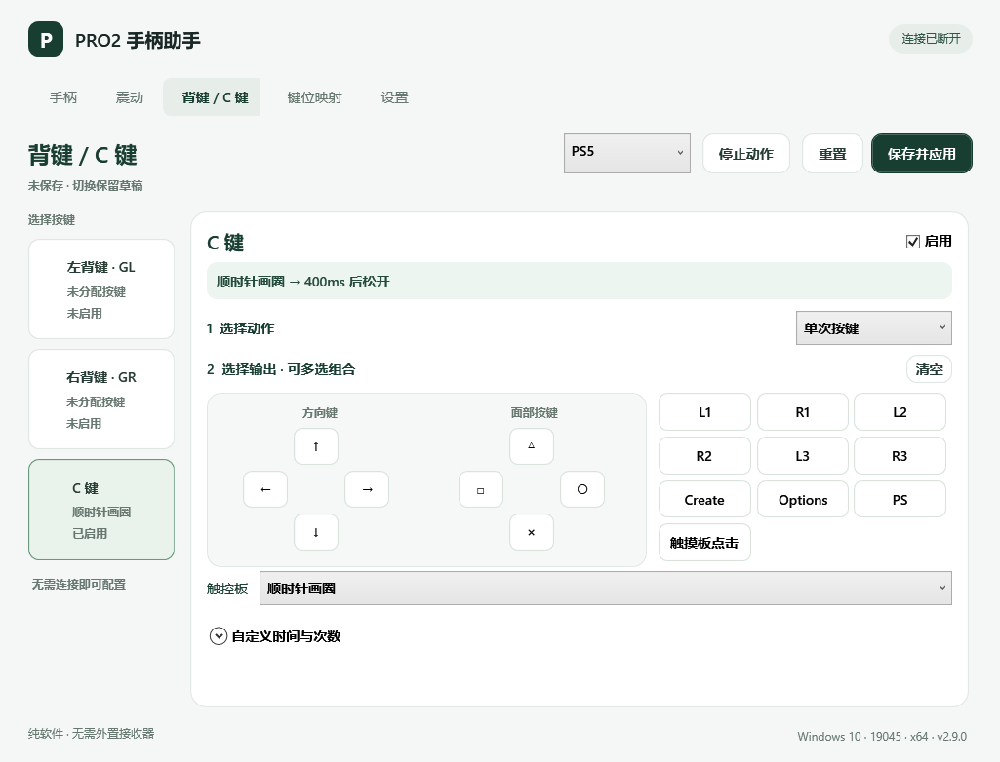

# PRO2 手柄助手

让 **Nintendo Switch 2 Pro（Pro2）手柄无线连接 Windows**，用于 Steam，也能切换成 Pro1、Xbox 或 PS5 兼容手柄。纯软件连接，无需专用接收器。

**[推荐下载：v2.9 Windows EXE](https://github.com/LeonChrome/XinHeLianSheng-Pro2-Bridge/releases/download/pro2-v2.9/PRO2ControllerAssistant-v2.9-win-x64.exe)** · [备用 ZIP 文件夹版](https://github.com/LeonChrome/XinHeLianSheng-Pro2-Bridge/releases/download/pro2-v2.9/PRO2ControllerAssistant-v2.9-portable-win-x64.zip) · [更新说明](docs/RELEASE_v2.9_ZH.md)

EXE 首次打开会准备内置运行文件，请稍等几秒。ZIP 需先完整解压。两者均自带 .NET 和 VIIPER。

**[v3.0.1 多输入预览](https://github.com/LeonChrome/XinHeLianSheng-Pro2-Bridge/releases/tag/pro2-v3.0.1-preview)**：新增 Pro1 蓝牙／USB、Pro2 USB 输入，以及 Pro1 蓝牙 NFC 只读实验。新通路已通过离线回放，尚待实机验收；稳定版继续保留 v2.9。[接入与限制](docs/physical-inputs.md)

## 主要功能

- **四种模式**：Steam / Pro2、Pro1、Xbox、PS5 兼容输出。
- **键位与摇杆**：ABXY 按位置、字母或自定义映射；左右摇杆死区独立调节，可设为 0%。未连接也能配置。
- **背键 / C 键**：Pro1、Xbox、PS5 支持单键、组合键、连发、顺序动作与延迟；按方位点选，预览执行顺序。PS5 另支持触控板点击、滑动和画圈。
- **震动与体感**：震动强度调节、PS5 普通震动与触觉转换、陀螺仪校准。Xbox 模式不含原生体感。
- **多手柄**：四个独立槽位，各自选择模式；可同模式或混用。多只实体手柄的并发速率与长时间稳定性仍以实测为准。
- **状态与连接**：真实 FD2 输入频率、电量档位、固件、耳机插入状态；自动重连、可选自动休眠、首页低速诊断和蓝牙优化。
- **游戏图标**：《影之刃零》Steam 版可按实际位置显示 Pro2 键名，支持多 Steam 库、安装与还原；按资源标识检查兼容性。

## 使用方法

1. 从托盘退出旧助手，打开新版；手柄保持 **PRO2 模式**，开启配对广播。
2. 点击“连接 Pro2”，选择游戏模式。无需先在 Windows 蓝牙设置里添加手柄。
3. 首次使用按提示安装内置 **USBIP 驱动**，可能需要管理员授权或重启。已安装但没找到时，会弹出文件选择窗口，指定安装目录里的 `usbip.exe`；以后也可在设置中更改。

默认按位置对应：**Pro2 下方 B → Xbox A / PS5 ×**。调整后以“键位映射”页为准；Steam Input、游戏中的改键仍会继续生效。背键 / C 键单独设置，不会再经 ABXY 二次转换。同种输出模式共用该模式的映射配置。

摇杆死区位于 **键位映射 → 摇杆中心死区**，默认沿用 4%；游戏自身的死区需在游戏中另调。

## v2.9 更新

- 改进启动封装，校验运行文件，加入原生异常记录与一次兼容回退。
- 修正 USBIP 输出堵塞导致的检测超时，扩大路径查找，支持手动绑定非默认位置。
- 新增左右摇杆死区调节，减少死区时不再把持续的小幅移动自动归零。
- 重做背键 / C 键编辑界面，保留松开停止、切换取消等保护。
- 扩充蓝牙名称 / UUID 识别与未匹配广播记录，方便手动连接及判断失败阶段。
- 图标补丁不再绑定整个游戏 EXE 的哈希；资源匹配时允许游戏更新后的版本，结构不匹配时仍可还原。
- 包含休眠后重连改进，避免上一轮 GATT 请求未结束时叠加新请求。

## 兼容性与说明

支持 **Windows 10 2004 及以上 / Windows 11 x64**，电脑需有可用的 BLE 蓝牙。目标是真实 **133Hz**，达到 **60Hz** 也允许兼容游玩。Win11 自动尝试连接参数；Win10 可按首页引导授权优化，修改前自动备份，并提供恢复。Win10 优化涉及全局 BLE 参数，可能影响其他蓝牙设备或需要重启。

实际速率受系统、适配器、驱动和无线环境影响，不保证所有电脑达到 133Hz。USBIP 虚拟输出与真实 BLE 输入分开诊断；虚拟重复报告不算新输入。PS5 触觉是转换输出；无线耳机音频和跨设备蓝牙转发尚不支持。

**自动休眠默认关闭。** 启用后本机可能占用手柄配对记录，挤掉原来的 NS2 主机记录；回主机时若连不上，重新配对即可。

[反馈问题](https://github.com/LeonChrome/XinHeLianSheng-Pro2-Bridge/issues) · [源码与构建](source/final-three-in-one/README.md) · [许可证](LICENSE) · [第三方致谢](ACKNOWLEDGEMENTS.md) · [历史版本](https://github.com/LeonChrome/XinHeLianSheng-Pro2-Bridge/releases)
